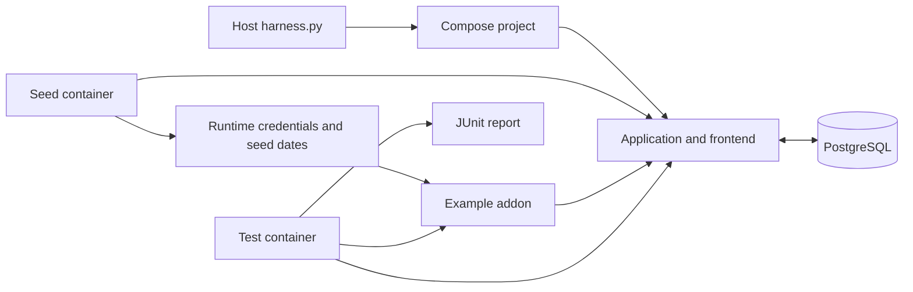

# Architecture

## Overview

The controller orchestrates PostgreSQL 16.13, Redis 7.4.8, wger web/Celery worker and nginx frontend. Seed and test tools run as one-shot containers; the example addon reads the same real API as an external integration.



The wger seed path uses Django ORM access directly inside the app container; the diagram’s application edge represents that environment. The example addon and integration assertions use HTTP.

## Components

### Controller and Compose

`harness.py` generates local state, selects the base/optional override files, and invokes Compose with explicit profiles. Health dependencies order database, server and frontend readiness. Loopback port bindings expose only the frontend and addon to the host.

### Seed and credentials

`scripts/seed.py` creates the demo fixture and credentials. The seeder runs inside the pinned Django application in a database transaction using stable UUIDs and lookup keys. It writes runtime credentials after the transaction commits. Its default history contains logs grouped by date, not explicit session objects.

### Client and addon

`scripts/client.py` uses Python's standard-library HTTP/cookie support. `scripts/addon.py` serves snapshots through `ThreadingHTTPServer`, with HTTP 503 for read failures. The addon receives runtime state read-only.

### Tests and reports

`tests/test_harness.py` discovers `test_*.py` with unittest, exercises authenticated reads, unauthenticated rejection and an isolated write/read/delete, then writes JUnit XML to the report mount.

## Data flow

`up` initializes local files, starts/waits for Compose services, seeds, and starts the addon. The addon reads the persisted credentials and fetches a snapshot for each request. `test` repeats startup/seeding before its assertions. `down` retains data; `reset --yes` deletes project volumes and regular generated files.

## Directory layout

```text
harness.py                   Host controller with no pip dependencies
compose.yaml                 Pinned application, infrastructure and tool profiles
compose.addon.example.yaml   Replacement-addon override example
scripts/                     Seed, shared client and HTTP addon
tests/                       Containerized unittest checks
runtime/                     Ignored generated credentials and seed state
reports/                     Ignored JUnit and optional failure logs
upstream.json                Tested image digests, version and source revision
```

Trace startup with `python harness.py up`, then use `python harness.py status` to inspect the tool and application lifecycles.
